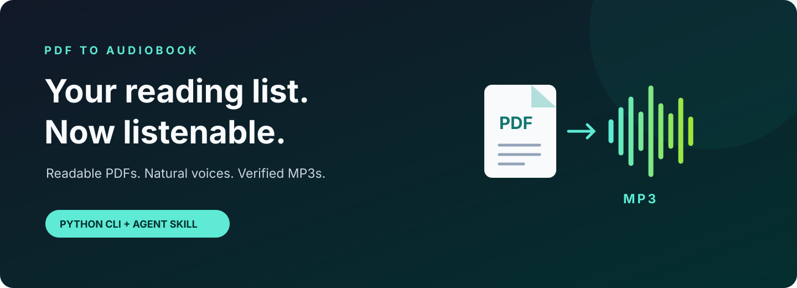

<p align="center">
  
</p>

<p align="center">
  
  
  
</p>

<h1 align="center">Give your PDFs a voice.</h1>

<p align="center">Turn readable PDFs into MP3 audiobooks.<br>Open the desktop menu. Run it from Python. Or ask your coding agent.</p>

---

Books. Essays. Long conversations. The documents you keep meaning to read.
Make them listenable, with a voice you choose and a transcript you can inspect.

**One PDF → one MP3. Multiple PDFs → an audiobook batch.**

- **Natural online voices.** Choose a language, accent, and voice from the live Edge-TTS catalog. No API key required.
- **Check the words first.** Preview extraction before sending text for speech synthesis.
- **Keep the story intact.** Preserve prefaces, chapter titles, and short passages; clean up recurring headers and PDF line breaks.
- **Know when it fails.** Suspected scanned pages stop conversion. Batch failures are recorded, not disguised as success.
- **Get a verified result.** Audio is decoded with FFmpeg before the final MP3 is delivered.
- **Use your own workflow.** A desktop voice menu, standalone Python CLI, and a portable skill for compatible coding agents.

## Quick start

Requires **Python 3.10+**. Download the repository ZIP or clone your published fork, then open a terminal in the extracted folder.

**Windows / PowerShell**

```powershell
python -m venv .venv
.\.venv\Scripts\python.exe -m pip install -r scripts/requirements.txt
.\.venv\Scripts\python.exe scripts/pdf_to_mp3.py book.pdf
```

**Linux / macOS**

```bash
python3 -m venv .venv
.venv/bin/python -m pip install -r scripts/requirements.txt
.venv/bin/python scripts/pdf_to_mp3.py book.pdf
```

The converter is written for Windows, Linux, and macOS. This release has been exercised locally on Windows; the included GitHub Actions workflow runs offline checks on all three operating systems when enabled on your repository. SAPI offline narration is Windows-only.

FFmpeg is provided by `imageio-ffmpeg` when a system executable is unavailable. A separate FFmpeg/FFprobe installation is optional. No desktop GUI is required.

## Open the desktop menu

Prefer choosing your PDF and voice in a window? The original SimpleAudioBookGen-derived interface is now bundled with the skill. It includes PDF selection and drag-and-drop, output path, audio quality, voice engines, document language, voice selection, voice preview, estimates, and progress.

Install the optional Qt interface using your virtual environment's Python:

```bash
python -m pip install -r scripts/requirements-gui.txt
python scripts/launch_gui.py
```

On Windows, use `.\.venv\Scripts\python.exe` instead of `python`; on Linux/macOS use `.venv/bin/python`, unless your environment is already activated. This opens a visible window without starting a conversion. To preselect a file:

```bash
python scripts/launch_gui.py --pdf book.pdf
```

The launcher uses relative resources: **no separate SimpleAudioBookGen installation, local project folder, or hardcoded username is needed**. CLI-only users do not need PySide6. The GUI requires a graphical desktop and is intended for local sessions, not a remote headless terminal.

By default, GUI settings and logs live under `%LOCALAPPDATA%/PDFToAudiobook` on Windows, `~/Library/Application Support/PDFToAudiobook` on macOS, or `$XDG_CONFIG_HOME/PDFToAudiobook` (falling back to `~/.config/PDFToAudiobook`) on Linux. Use `--state-dir PATH` to override this. The GUI offers to confirm replacement of an existing output; the CLI generates unique names automatically.

Diagnostics:

```bash
python scripts/launch_gui.py --check
python scripts/launch_gui.py --foreground
python scripts/launch_gui.py --smoke-test
```

The GUI's voice menu is a bundled catalog; the CLI's `--list-voices` fetches the current online catalog. Optional Kokoro/Piper modes retain their original manual model setup and are not installed by the GUI requirements. Basic System Voice is Windows-only. Previewing online voices sends sample text to the speech provider; opening the window alone does not start narration.

## Make it yours

Examples below use `python` as shorthand for your virtual environment's Python executable.

```bash
# Review the transcript locally. No speech request is made.
python scripts/pdf_to_mp3.py book.pdf --dry-run

# Spanish from Spain, female voice
python scripts/pdf_to_mp3.py book.pdf --language es --voice es-ES-ElviraNeural

# US English, a little faster
python scripts/pdf_to_mp3.py book.pdf --voice en-US-GuyNeural --rate=+10%

# Batch conversion, custom destination
python scripts/pdf_to_mp3.py book.pdf essay.pdf --output-dir my-audiobooks

# Discover current voices in a language
python scripts/pdf_to_mp3.py --list-voices --language es

# Installed Windows voices, without online speech processing
python scripts/pdf_to_mp3.py book.pdf --engine sapi
python scripts/pdf_to_mp3.py --list-voices --engine sapi
```

Choose the voice for the document's language. The tool **does not translate**. Spanish-specific number and abbreviation normalization is applied to Spanish; other languages retain their wording rather than receive Spanish substitutions.

Voice availability comes from a third-party service and may change. The live catalog is the source of truth; a listed voice is not a guarantee that every synthesis request will succeed.

## Use it as an agent skill

Copy the repository contents into a folder named `pdf-to-audiobook` in your agent's skill directory. For Codex, use `$CODEX_HOME/skills/pdf-to-audiobook`, or `~/.codex/skills/pdf-to-audiobook` when `CODEX_HOME` is unset. Follow your host's refresh/reload procedure if the skill is not discovered immediately.

Then attach your PDFs and ask:

```text
$pdf-to-audiobook turn these PDFs into audiobooks in their original language.
```

Or be specific:

```text
$pdf-to-audiobook narrate this Spanish PDF with es-ES-ElviraNeural, at normal speed.
```

The skill resolves its own directory and Python environment. It contains no machine-specific paths and does not depend on the original SimpleAudioBookGen project. Hosts without skill support can run the CLI directly.

Ask for the window with:

```text
$pdf-to-audiobook open the menu
```

Invoking the skill without PDFs or another task also opens the menu. Supplying PDFs with a narration request keeps the direct conversion workflow.

## What you receive

By default, files go to `outputs/audiobooks/`:

```text
book.mp3       Narration, 192 kbps by default
book.txt       Words sent for narration, in reading order
report.json    Per-file status, voice, duration, and audio validation
```

Existing names receive suffixes such as `book_2.mp3`; reports are also numbered. A preview creates text and a report, so a subsequent conversion may use a suffix. Logs stay in `work/pdf-to-audiobook/`, and temporary chunk audio is cleaned up after each conversion. The CLI returns `0` when the entire batch succeeds and `1` if a document fails.

## How it works


The adapted core and desktop interface come from [SimpleAudioBookGen](https://github.com/alegp97/SimpleAudioBookGen). This project adds a portable agent workflow and a headless batch interface; Qt is an optional dependency for the menu.

## Privacy and practical limits

- **Online mode:** Edge-TTS receives text fragments for narration. It requires internet. Extraction, cleanup, assembly, and reports run locally.
- **Offline mode:** Windows SAPI uses installed system voices. No text is sent to an online speech service by this mode.
- **PDF support:** Selectable text is required. OCR is not included. Image-only and suspicious mixed pages are rejected. Very sparse PDFs may also be rejected by the inherited text threshold.
- **Reading order:** Columns, tables, formulas, and elaborate layouts need transcript review. Automated cleanup is heuristic.
- **Language:** The interface is English. Voice selection supports the service's language catalog; specialized normalization is currently Spanish-only.
- **Long books:** Audio assembly currently uses memory proportional to the decoded audio. Multi-hour documents may require substantial RAM.
- **Service terms:** Online speech availability and permitted use depend on the external provider. No claim of unlimited use or commercial service rights is made.

## Development

```bash
python -m unittest discover -s tests -v
python -m compileall -q scripts tests
```

Tests generate their own PDFs and synthetic audio. They do not send document text to a speech service. The CI matrix includes Windows, Linux, macOS, and Python 3.10/3.13. See [CONTRIBUTING.md](CONTRIBUTING.md) for focused contribution guidance and [references/design.md](references/design.md) for provenance.

GUI-enabled environments also run a window/preferences smoke test. CI installs the optional GUI dependencies separately and checks the offscreen menu on Python 3.13 across the three operating systems. Local validation is on Windows; verify the remote CI results after publication.

## License and attribution

This repository's source is licensed under [MIT](LICENSE). The adapted SimpleAudioBookGen code retains its [original MIT notice](scripts/vendor/LICENSE). Dependencies and bundled media tools have their own licenses; see [THIRD_PARTY_NOTICES.md](THIRD_PARTY_NOTICES.md).
